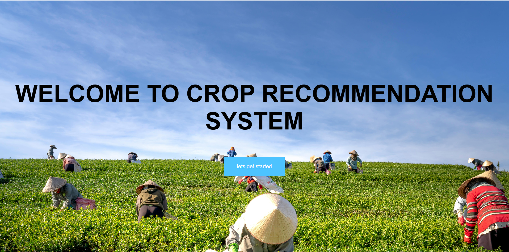
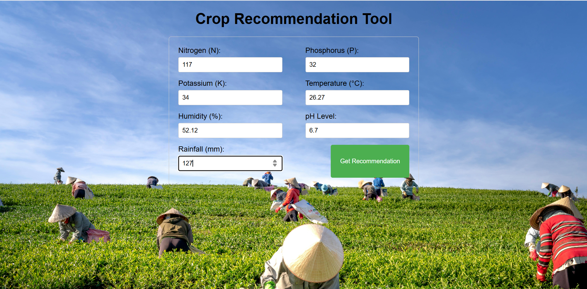
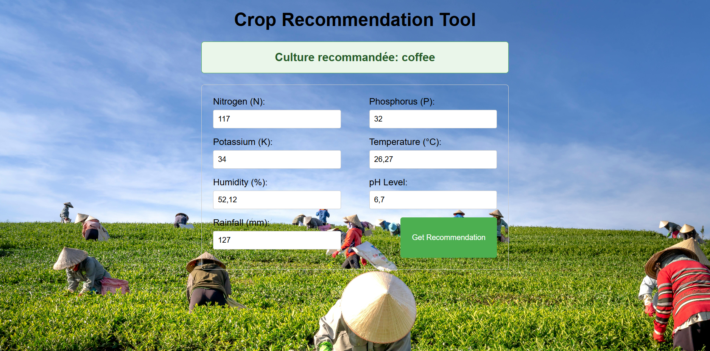

# Crop Recommendation System

### Machine Learning-Based Crop Recommendation Web Application

A machine learning project that recommends suitable crops based on soil characteristics and environmental conditions.

The project combines **data analysis, machine learning, and web development** to build a crop recommendation system. A classification model is trained using agricultural data and integrated into a Django web application, allowing users to obtain crop recommendations through a simple interface.



## Project Overview

Choosing a suitable crop depends on several factors, including soil nutrients, temperature, humidity, soil pH, and rainfall.

The objective of this project is to explore how machine learning can help identify a suitable crop based on these agricultural and environmental characteristics.

The project covers the following steps:

1. Exploring and understanding the agricultural dataset.
2. Checking data quality and analyzing feature relationships.
3. Training and comparing machine learning classification models.
4. Evaluating the selected model.
5. Saving the trained model using Pickle.
6. Integrating the model into a Django web application.


## Project Objectives

- Explore agricultural data and identify patterns in soil and environmental conditions.
- Build a multiclass classification model to recommend crops.
- Compare different machine learning algorithms.
- Evaluate prediction performance on unseen test data.
- Develop a user-friendly web interface for crop recommendations.
- Connect a trained machine learning model to a Django application.

## Technologies Used

| Category | Technologies |
|----------|--------------|
| Programming Language | Python |
| Data Analysis | Pandas, NumPy |
| Data Visualization | Matplotlib, Seaborn |
| Machine Learning | Scikit-learn |
| Model Serialization | Pickle |
| Web Framework | Django |
| Frontend | HTML, CSS |
| Development Environment | Jupyter Notebook |
| Version Control | Git, GitHub |

---

## Dataset Description

The model was developed using a crop recommendation dataset containing **2,200 observations** and **22 crop categories**.

Each crop category contains 100 observations.

### Dataset Features

| Feature | Description |
|---------|-------------|
| N | Nitrogen content in the soil |
| P | Phosphorus content in the soil |
| K | Potassium content in the soil |
| temperature | Temperature in degrees Celsius |
| humidity | Relative humidity (%) |
| ph | Soil pH level |
| rainfall | Rainfall in millimeters |
| label | Crop category (target variable) |

### Dataset Summary

| Metric | Value |
|--------|-------|
| Total observations | 2,200 |
| Input features | 7 |
| Target variable | Crop type |
| Crop categories | 22 |
| Missing values | 0 |
| Duplicate rows | 0 |

The dataset contains the following crops:

Rice, Maize, Jute, Cotton, Coconut, Papaya, Orange, Apple, Muskmelon, Watermelon, Grapes, Mango, Banana, Pomegranate, Lentil, Blackgram, Mungbean, Mothbeans, Pigeonpeas, Kidneybeans, Chickpea, and Coffee.

## Exploratory Data Analysis (EDA)

Before training the models, exploratory data analysis was performed to understand the dataset and examine data quality.

The analysis included:

- Inspecting the dataset structure and data types.
- Checking for missing values.
- Identifying duplicate records.
- Computing descriptive statistics.
- Examining the distribution of crop categories.
- Analyzing correlations between numerical features.
- Visualizing correlations using a heatmap.

## Machine Learning Approach

### 1. Data Preparation

The crop names were converted into numerical class labels for machine learning.

The dataset was divided into:

- **80% training data:** 1,760 observations
- **20% testing data:** 440 observations

The final model was serialized using Python's `pickle` module and saved as:

`crop_recommendation_model.pkl`

## Crop Recommendation Workflow

The recommendation system takes seven numerical inputs and returns a predicted crop.

```text
          User Input
              |
              v
  Soil Nutrients (N, P, K)
              +
  Environmental Conditions
  (Temperature, Humidity,
       pH, Rainfall)
              |
              v
       Django Web App
              |
              v
       Input Processing
              |
              v
    Trained Decision Tree
              |
              v
       Crop Prediction
              |
              v
    Recommended Crop Name
```

### Crop Recommendation Form

The user enters seven soil and environmental parameters through the web interface.



### Example Input

The training notebook includes the following prediction example:

| Parameter | Value |
|-----------|-------|
| Nitrogen (N) | 117 |
| Phosphorus (P) | 32 |
| Potassium (K) | 34 |
| Temperature | 26.27 °C |
| Humidity | 52% |
| pH | 6.7 |
| Rainfall | 127.17 mm |

**Recorded prediction:** Coffee

---

## Django Web Application

The trained model is integrated into a Django application.

The interface allows users to enter soil and environmental measurements and request a crop recommendation.

### Main Features

- Homepage introducing the crop recommendation system.
- Form for entering the seven numerical parameters.
- Integration with a serialized machine learning model.
- Crop prediction based on the submitted values.
- Display of the recommended crop.
- Basic input validation for missing or invalid values.

### Prediction Result

After submitting the form, the application processes the input values and displays the recommended crop.



**Training notebook:** `crop_recommendation-checkpoint.ipynb`

---

## Installation and Setup

### 1. Clone the Repository

```bash
git clone https://github.com/Lidelle123/crop_recommendation_system.git
cd crop_recommendation_system
```

### 2. Create a Virtual Environment

```bash
python -m venv venv
```

Activate it 

### 3. Install Dependencies

```bash
pip install django scikit-learn pandas numpy matplotlib seaborn
```

### 4. Open the Django Project

```bash
cd crop_recommendation
```

### 5. Start the Development Server

```bash
python manage.py runserver
```

If the Django configuration requires database setup, run:

```bash
python manage.py migrate
```

### 6. Open the Application

Visit:

http://127.0.0.1:8000/

Then:

1. Click the button to access the recommendation form.
2. Enter the seven soil and environmental parameters.
3. Submit the form.
4. View the recommended crop.

---
